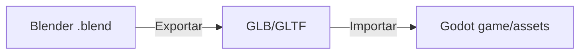

# Modelagem 3D — Blender

Este diretório concentra os arquivos-fonte de modelagem 3D do **DinoMath Run**, organizados por categoria. A partir deles são exportados os assets **GLB/GLTF** consumidos pelo jogo no Godot.

## Estrutura

```
blender/
├── dinosaur/
│   └── dinosaur.blend        → Dinossauro principal (modelo + rig + animações)
│
├── obstacles/
│   ├── cactus.blend          → Cacto padrão
│   └── cactus_02.blend       → Variação de cacto
│
└── environment/
    ├── rocks.blend           → Pedras/decorativos
    └── desert.blend          → Cenário de deserto
```

> **Nota:** os arquivos `.blend` atuais são apenas *placeholders* para manter a estrutura no repositório. Substitua cada um pelo arquivo real modelado no Blender.

## Pipeline de exportação



## Convenções (ver GDD — Seção 30)

- **Escala**: manter escala 1:1 (1 unidade Blender = 1 metro), consistente entre todos os assets.
- **Aplicar transformações**: aplicar escala e rotação antes de exportar (`Ctrl+A`), evitando problemas de importação no Godot.
- **Orientação**: modelos orientados seguindo o padrão usado na cena do jogo (Y-frente / Z-cima).
- **Nomenclatura**: usar nomes descritivos e consistentes nos *objects*, *materials* e arquivos.

## Como usar

1. Abra o arquivo `.blend` desejado no Blender.
2. Modele seguindo as convenções acima.
3. Exporte como **GLB** (`File → Export → glTF 2.0`, opção *glTF Binary (.glb)*).
4. Coloque o arquivo exportado em `game/assets/` (e importe no Godot).

## Referências

- [Game Design Document](../docs/DinoMath_GDD.md) — detalhes dos assets e pipeline (Seção 30).
