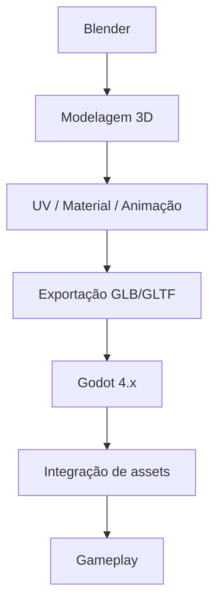
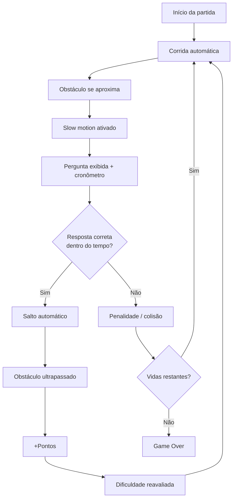
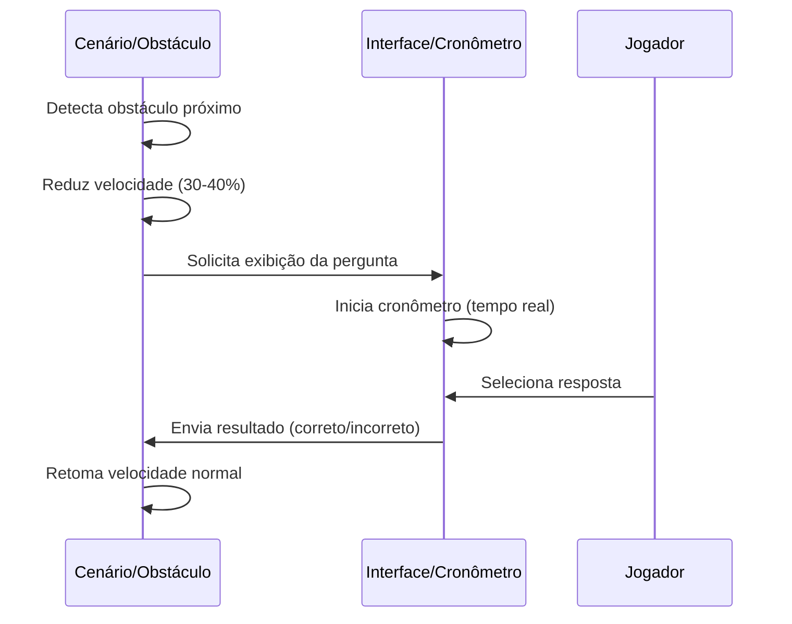
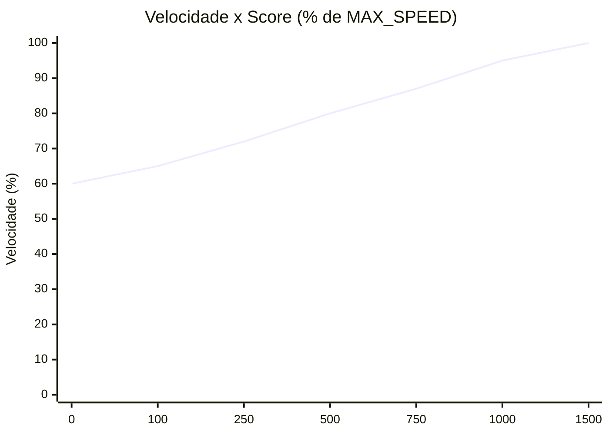
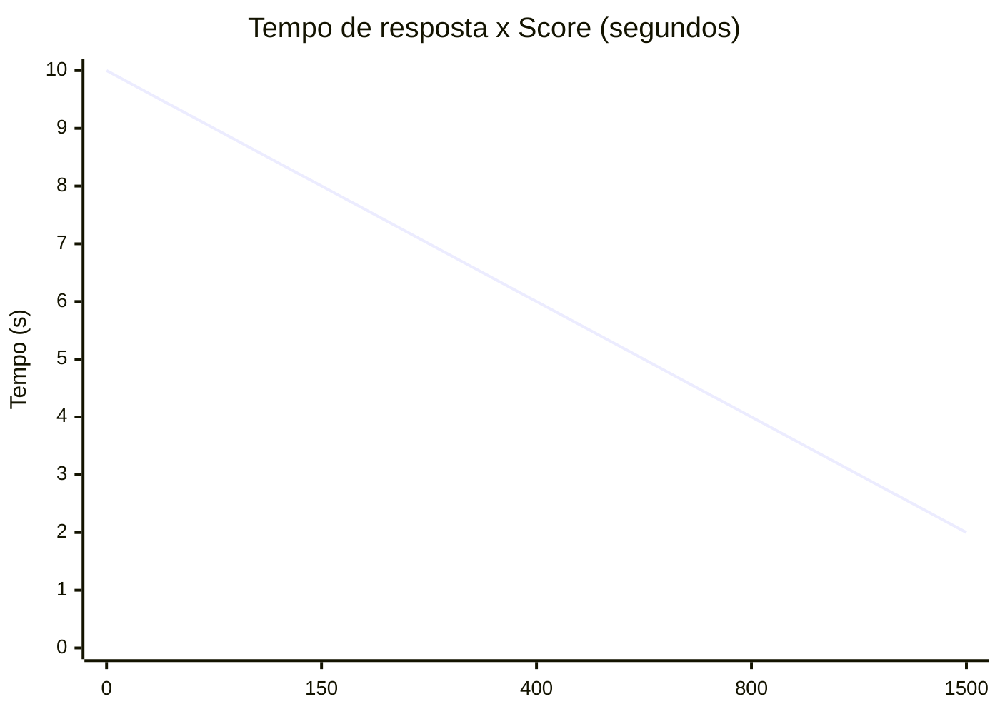
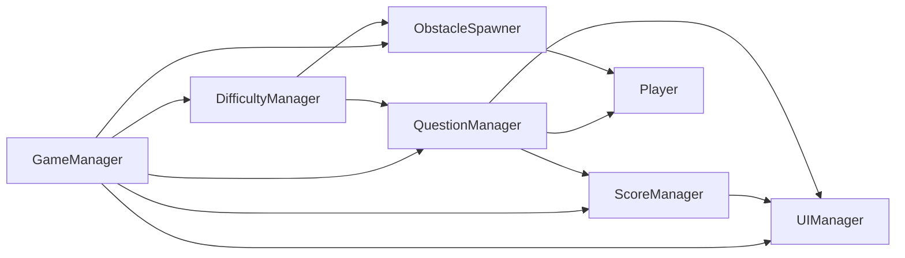
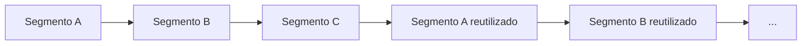
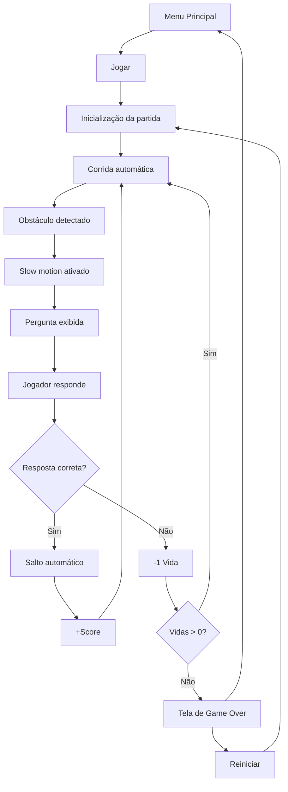
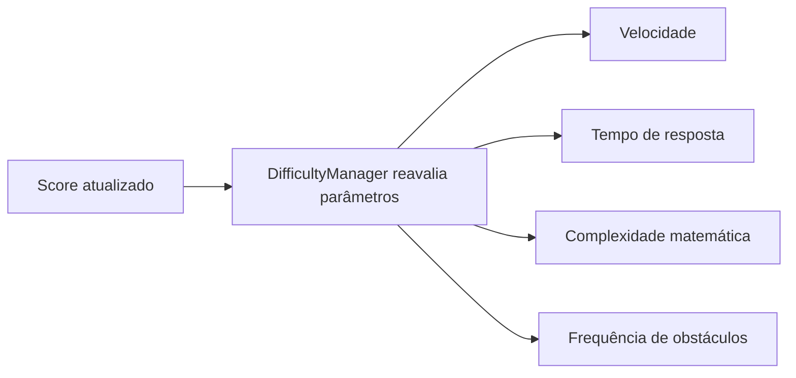

<div align="center">

# 🦖 DinoMath Run

### Game Design Document

**Versão:** 1.1
**Data:** 18 de agosto de 2026
**Equipe:** [Marcos Henrique](https://github.com/marcos-henri) · [William Araújo](https://github.com/WilliamOut) · [Kelvin Oliveira](https://github.com/kelvin-oliveira-dev)
**Instituição:** Unijorge
**Disciplina:** Computação Gráfica

</div>

---

## Controle de Versão

| Versão | Data | Autor(es) | Descrição |
|---|---|---|---|
| 1.0 | 18/08/2026 | Marcos Henrique, William Araújo, Kelvin Oliveira | Versão inicial do documento, escopo de MVP definido |

---

## Sumário

- [🦖 DinoMath Run](#-dinomath-run)
  - [Game Design Document](#game-design-document)
  - [Controle de Versão](#controle-de-versão)
  - [Sumário](#sumário)
  - [1. Identidade do Projeto](#1-identidade-do-projeto)
    - [Conceito central](#conceito-central)
    - [Pilares de design](#pilares-de-design)
  - [2. Objetivo Educacional](#2-objetivo-educacional)
  - [3. Público-Alvo](#3-público-alvo)
  - [4. Plataforma e Tecnologias](#4-plataforma-e-tecnologias)
    - [Stack recomendada](#stack-recomendada)
    - [Por que Godot em vez de Unity ou Unreal](#por-que-godot-em-vez-de-unity-ou-unreal)
    - [Pipeline de produção](#pipeline-de-produção)
    - [Especificações técnicas](#especificações-técnicas)
  - [5. Escopo do MVP](#5-escopo-do-mvp)
    - [Obrigatório no MVP](#obrigatório-no-mvp)
    - [Fora do escopo do MVP](#fora-do-escopo-do-mvp)
  - [6. Gameplay](#6-gameplay)
    - [Loop principal](#loop-principal)
  - [7. Mecânica de Tempo](#7-mecânica-de-tempo)
    - [Abordagem recomendada (simples e segura)](#abordagem-recomendada-simples-e-segura)
    - [Alternativa mais simples ainda](#alternativa-mais-simples-ainda)
    - [Riscos da abordagem por escala de tempo global (`Engine.time_scale`)](#riscos-da-abordagem-por-escala-de-tempo-global-enginetime_scale)
  - [8. Sistema de Perguntas](#8-sistema-de-perguntas)
    - [Regras gerais de geração](#regras-gerais-de-geração)
    - [Tipos de questão suportados](#tipos-de-questão-suportados)
    - [Pseudocódigo de geração](#pseudocódigo-de-geração)
    - [Geração de alternativas (múltipla escolha)](#geração-de-alternativas-múltipla-escolha)
  - [9. Sistema de Dificuldade](#9-sistema-de-dificuldade)
    - [Variáveis que podem aumentar com a dificuldade](#variáveis-que-podem-aumentar-com-a-dificuldade)
    - [9.1. Progressão de Velocidade](#91-progressão-de-velocidade)
    - [9.2. Relação entre Velocidade e Tempo de Resposta](#92-relação-entre-velocidade-e-tempo-de-resposta)
    - [9.3. Curva de Dificuldade](#93-curva-de-dificuldade)
    - [9.4. Configurações Centralizadas](#94-configurações-centralizadas)
  - [10. Sistema de Pontuação](#10-sistema-de-pontuação)
    - [Combo (recurso secundário, opcional)](#combo-recurso-secundário-opcional)
  - [11. Vida e Game Over](#11-vida-e-game-over)
    - [Justificativa](#justificativa)
  - [12. Personagem](#12-personagem)
  - [13. Obstáculo](#13-obstáculo)
  - [14. Cenário](#14-cenário)
  - [15. Quantidade de Modelos 3D](#15-quantidade-de-modelos-3d)
    - [Modelos obrigatórios](#modelos-obrigatórios)
    - [Reuso de assets](#reuso-de-assets)
  - [16. Polígonos](#16-polígonos)
  - [17. Estilo Visual](#17-estilo-visual)
  - [18. Câmera](#18-câmera)
    - [Justificativa](#justificativa-1)
  - [19. Controles](#19-controles)
    - [Múltipla escolha vs. digitação da resposta](#múltipla-escolha-vs-digitação-da-resposta)
  - [20. Interface](#20-interface)
    - [HUD (durante a partida)](#hud-durante-a-partida)
    - [Menu principal](#menu-principal)
    - [Tela de jogo](#tela-de-jogo)
    - [Tela de Game Over](#tela-de-game-over)
  - [21. Áudio](#21-áudio)
  - [22. Arquitetura Godot](#22-arquitetura-godot)
  - [23. Sistemas Principais](#23-sistemas-principais)
  - [24. Geração Infinita](#24-geração-infinita)
    - [Geração de obstáculos](#geração-de-obstáculos)
  - [25. Performance](#25-performance)
  - [26. Fluxo do Jogo](#26-fluxo-do-jogo)
    - [Fluxo de dificuldade (paralelo ao fluxo principal)](#fluxo-de-dificuldade-paralelo-ao-fluxo-principal)
  - [27. Regras de Geração de Obstáculos](#27-regras-de-geração-de-obstáculos)
  - [28. Regras de Fair Play](#28-regras-de-fair-play)
  - [29. Computação Gráfica](#29-computação-gráfica)
  - [30. Blender](#30-blender)
    - [Pipeline recomendado](#pipeline-recomendado)
    - [Boas práticas](#boas-práticas)
  - [31. Organização de Equipe](#31-organização-de-equipe)
  - [32. Cronograma](#32-cronograma)
  - [33. Backlog](#33-backlog)
    - [Must Have](#must-have)
    - [Should Have](#should-have)
    - [Could Have](#could-have)
    - [Won't Have (neste projeto)](#wont-have-neste-projeto)
  - [34. Testes](#34-testes)
    - [Casos de teste básicos (exemplos)](#casos-de-teste-básicos-exemplos)
  - [35. Critérios de Aceitação](#35-critérios-de-aceitação)
  - [36. Riscos](#36-riscos)
  - [37. Funcionalidades Futuras](#37-funcionalidades-futuras)
  - [38. Escopo Final Recomendado](#38-escopo-final-recomendado)
  - [39. Documentação Visual](#39-documentação-visual)
  - [40. Formatação do Documento](#40-formatação-do-documento)
  - [41. Controle de Escopo](#41-controle-de-escopo)
  - [42. Conclusão](#42-conclusão)

---

## 1. Identidade do Projeto

**Nome provisório:** DinoMath Run
**Subtítulo:** A corrida que também é um cálculo
**Gênero:** Endless runner 3D educacional, estilo low-poly

### Conceito central

O jogador controla um dinossauro que corre automaticamente por um deserto tridimensional gerado de forma contínua. Ao longo do percurso, obstáculos surgem no caminho. Sempre que um obstáculo se aproxima o suficiente, o ritmo do jogo desacelera momentaneamente e uma operação matemática é exibida na tela. O jogador tem uma janela de tempo curta para resolver a conta e indicar a resposta correta.

Se a resposta estiver correta, o dinossauro salta automaticamente, ultrapassa o obstáculo e a corrida retoma o ritmo normal, somando pontos. Se a resposta estiver errada — ou se o tempo se esgotar — o jogador sofre uma penalidade, podendo colidir com o obstáculo.

Não existem fases no sentido tradicional: o jogo é infinito, e o objetivo é sobreviver o maior tempo possível, acumulando a maior pontuação.

### Pilares de design

| Pilar | Descrição |
|---|---|
| Ritmo | Alternância clara entre "correr" e "pensar", sem quebrar o fluxo da partida |
| Justiça | O jogador nunca deve enfrentar uma situação matematicamente impossível |
| Progressão previsível | A dificuldade cresce de forma suave e compreensível |
| Escopo enxuto | Um projeto pequeno, terminável, que ainda demonstra domínio de Computação Gráfica |

---

## 2. Objetivo Educacional

O objetivo educacional do DinoMath Run é reforçar, por meio de gamificação, a agilidade no cálculo mental com as quatro operações básicas: **adição, subtração, multiplicação e divisão**.

Além das operações diretas, o jogo também apresenta questões com **incógnitas** (valor desconhecido) e com **operador desconhecido**, estimulando o jogador a pensar sobre a estrutura da operação, e não apenas em executá-la mecanicamente.

Exemplos de formatos de questão trabalhados:

- `2 + 2 = ?` (resultado desconhecido)
- `2 - ? = 0` (operando desconhecido)
- `2 ? 1 = 3` (operador desconhecido)
- `? + 5 = 9` (primeiro operando desconhecido)
- `12 - ? = 7` (segundo operando desconhecido)
- `3 × ? = 12` (operando desconhecido em multiplicação)
- `? ÷ 4 = 3` (operando desconhecido em divisão)

As habilidades trabalhadas são:

- cálculo mental básico;
- raciocínio rápido sob pressão de tempo;
- atenção e leitura rápida de enunciados curtos;
- reconhecimento de relações entre operações (ex.: subtração como inversa da adição).

As regras completas de geração dessas questões estão detalhadas na Seção 8.

---

## 3. Público-Alvo

O DinoMath Run é destinado a **jogadores casuais**, aproximadamente entre **8 e 14 anos**, que já tenham contato inicial com as quatro operações básicas e desejem revisá-las de forma leve e divertida. O jogo também é adequado como atividade de revisão para qualquer pessoa que queira treinar agilidade em cálculo mental.

É importante deixar explícito que:

- o jogo **não** é uma ferramenta pedagógica profissional nem um sistema de ensino estruturado;
- **não** há trilhas de aprendizagem, relatórios de desempenho pedagógico ou adaptação curricular;
- o foco é **prática e revisão de operações básicas por meio de um jogo casual**, apropriado ao escopo de um projeto acadêmico de Computação Gráfica.

---

## 4. Plataforma e Tecnologias

### Stack recomendada

| Camada | Tecnologia |
|---|---|
| Engine | Godot Engine 4.x |
| Linguagem de script | GDScript |
| Modelagem 3D | Blender |
| Formato de intercâmbio | GLB/GLTF |

### Por que Godot em vez de Unity ou Unreal

Para um projeto acadêmico pequeno, com equipe de três pessoas e prazo curto, Godot 4.x é a opção mais adequada pelos seguintes motivos:

- **Curva de aprendizado menor**: GDScript tem sintaxe simples, próxima de Python, reduzindo o tempo de adaptação da equipe.
- **Motor leve**: instalação rápida, projetos pequenos, builds rápidas — importante para máquinas acadêmicas comuns.
- **Integração nativa com Blender**: importação direta de arquivos GLB/GLTF sem etapas intermediárias complexas.
- **Sem custo de licença ou royalties**: Godot é open-source, o que evita qualquer burocracia de licenciamento para um projeto de disciplina.
- **Ausência de excesso de recursos**: Unity e Unreal oferecem sistemas voltados a jogos de grande escala (redes complexas, marketplaces, pipelines gráficos avançados) que não são necessários aqui e apenas aumentariam a complexidade de aprendizado.
- **Prototipagem rápida**: cenas e scripts simples permitem iterar rapidamente sobre a mecânica de perguntas e o endless runner sem overhead de configuração.

Em resumo: o projeto não exige nada que justifique a complexidade adicional de Unity ou Unreal, e Godot entrega tudo o que é necessário com menor esforço de configuração e aprendizado.

### Pipeline de produção



### Especificações técnicas

| Item | Definição |
|---|---|
| Resolução base | 1280×720 (16:9), com suporte a tela cheia |
| Plataforma principal | PC |
| Sistema operacional prioritário | Windows |
| Suporte adicional | Linux (via exportação nativa do Godot) |
| Dispositivo de entrada | Teclado |
| Suporte a mobile no MVP | **Não** |

---

## 5. Escopo do MVP

### Obrigatório no MVP

- Menu principal
- Loop de jogo endless runner
- Dinossauro 3D controlável (corrida e salto automáticos)
- Cenário low-poly gerado de forma modular/infinita
- Pelo menos um tipo principal de obstáculo, com pequenas variações
- Sistema de geração de perguntas matemáticas
- Mecanismo de entrada de resposta (múltipla escolha)
- Limite de tempo por pergunta
- Desaceleração temporal (slow motion) ao se aproximar de obstáculos
- Sistema de pontuação
- Dificuldade progressiva baseada no score
- Detecção de colisão
- Tela de Game Over
- Opção de reiniciar a partida
- Recorde local (salvo entre sessões)

### Fora do escopo do MVP

- Multiplayer
- Ranking online
- Sistema de login/autenticação
- Banco de dados externo
- Loja e monetização
- Skins e sistema de inventário
- Mundo aberto
- Narrativa complexa e cutscenes
- Grande elenco de personagens ou ambientes
- Qualquer funcionalidade dependente de servidor

Esses itens são listados na Seção 37 como possíveis expansões futuras, mas não fazem parte da entrega obrigatória do projeto.

---

## 6. Gameplay

### Loop principal

1. O jogador inicia a partida a partir do menu.
2. O dinossauro começa a correr automaticamente.
3. O cenário é gerado/movimentado continuamente.
4. Um obstáculo é instanciado à frente.
5. O obstáculo se aproxima do jogador.
6. Ao atingir uma distância de gatilho, o jogo entra em modo de desaceleração (slow motion).
7. Uma questão matemática é exibida na tela.
8. Uma contagem regressiva é iniciada.
9. O jogador seleciona uma resposta entre as alternativas.
10. Se a resposta estiver correta, o dinossauro salta automaticamente.
11. O obstáculo é ultrapassado e o jogo retoma a velocidade normal.
12. A pontuação aumenta.
13. A dificuldade é reavaliada de acordo com o novo score.
14. Um novo obstáculo é gerado adiante.
15. O ciclo se repete indefinidamente.
16. Em caso de falha (resposta errada ou tempo esgotado), o dinossauro segue sem salto automático e colide com o obstáculo, perdendo 1 vida; ao zerar as vidas, ocorre o Game Over.



---

## 7. Mecânica de Tempo

Este é um dos pontos centrais do jogo: transmitir a sensação de "bullet time" quando um obstáculo se aproxima, sem introduzir complexidade técnica desnecessária.

### Abordagem recomendada (simples e segura)

Em vez de alterar o tempo global do motor, recomenda-se **reduzir manualmente a velocidade de deslocamento do cenário e dos obstáculos** (multiplicando a velocidade atual por um fator, por exemplo 0.3–0.4) durante o período da pergunta, deixando o restante do jogo (interface, cronômetro, animações de UI) rodando normalmente.

O cronômetro da pergunta deve utilizar tempo real (por exemplo, baseado em `Time.get_ticks_msec()` ou em um nó `Timer` dedicado à UI), garantindo que ele **não** seja afetado pela desaceleração do mundo.

| Momento | Velocidade do mundo |
|---|---|
| Normal | 100% |
| Durante a pergunta | 30% a 40% |
| Após resposta | retorno gradual a 100% |

### Alternativa mais simples ainda

Caso a equipe prefira evitar qualquer interpolação de velocidade, uma alternativa é **pausar completamente o deslocamento do cenário e do obstáculo** (velocidade = 0) durante a pergunta, mantendo apenas as animações de "idle" do dinossauro. Isso remove a necessidade de transições suaves, ao custo de uma sensação mais abrupta.

### Riscos da abordagem por escala de tempo global (`Engine.time_scale`)

Ainda que tecnicamente simples, alterar `Engine.time_scale` afeta **todo** o projeto (animações, física, temporizadores padrão), o que pode:

- desacelerar acidentalmente o cronômetro da pergunta, se ele depender de um `Timer` comum;
- alterar a velocidade de animações de UI e efeitos sonoros vinculados a `_process`;
- introduzir bugs sutis de sincronização entre sistemas.

Por esse motivo, recomenda-se a abordagem manual (reduzir apenas a velocidade de cenário/obstáculos), que é mais previsível e fácil de depurar.



---

## 8. Sistema de Perguntas

O gerador de questões é o núcleo educacional do jogo. Todas as questões utilizam números de **no máximo dois dígitos** (0–99).

### Regras gerais de geração

- Nunca gerar divisão com resultado decimal no MVP (o divisor é escolhido de forma que o resultado seja sempre inteiro).
- Evitar resultados negativos nos níveis iniciais de dificuldade.
- Nunca gerar divisão por zero.
- Garantir que exista **exatamente uma** resposta correta para cada questão.
- A dificuldade matemática (intervalo dos números, operadores permitidos, presença de incógnitas) é controlada pelo `DifficultyManager` (ver Seção 9).
- Questões com incógnita ou operador desconhecido só são habilitadas a partir de determinado nível de dificuldade (ver tabela da Seção 9).

### Tipos de questão suportados

| Tipo | Exemplo | Descrição |
|---|---|---|
| Resultado desconhecido | `8 + 7 = ?` | Formato clássico |
| Operando desconhecido (1º termo) | `? + 7 = 12` | Testa a operação inversa |
| Operando desconhecido (2º termo) | `18 - ? = 9` | Testa a operação inversa |
| Operador desconhecido | `7 ? 2 = 14` | Jogador identifica qual operação foi usada |

### Pseudocódigo de geração

```
function generate_question(difficulty):
    operation = choose_operation(difficulty.allowed_operations)
    question_type = choose_question_type(difficulty.unknown_chance)

    repeat:
        a = random_int(difficulty.min_value, difficulty.max_value)
        b = random_int(difficulty.min_value, difficulty.max_value)

        if operation == DIVISION:
            b = random_int(1, difficulty.max_divisor)          # nunca zero
            a = b * random_int(1, difficulty.max_quotient)      # garante resultado inteiro

        result = apply_operation(a, b, operation)

    until is_valid(a, b, operation, result, difficulty)

    return build_question(a, b, operation, result, question_type)


function is_valid(a, b, operation, result, difficulty):
    if operation == SUBTRACTION and result < 0 and not difficulty.allow_negative:
        return false
    if operation == DIVISION and (b == 0 or result != floor(result)):
        return false
    if digit_count(a) > 2 or digit_count(b) > 2:
        return false
    return true


function build_question(a, b, operation, result, question_type):
    match question_type:
        case RESULT_UNKNOWN:
            text = "{a} {symbol(operation)} {b} = ?"
            correct_answer = result
        case FIRST_OPERAND_UNKNOWN:
            text = "? {symbol(operation)} {b} = {result}"
            correct_answer = a
        case SECOND_OPERAND_UNKNOWN:
            text = "{a} {symbol(operation)} ? = {result}"
            correct_answer = b
        case OPERATOR_UNKNOWN:
            text = "{a} ? {b} = {result}"
            correct_answer = operation

    return Question(text, correct_answer, difficulty.response_time)
```

### Geração de alternativas (múltipla escolha)

```
function generate_alternatives(correct_answer):
    alternatives = [correct_answer]

    while length(alternatives) < 4:
        distractor = correct_answer + random_int(-5, 5)
        if distractor >= 0 and distractor not in alternatives:
            alternatives.append(distractor)

    shuffle(alternatives)
    return alternatives
```

---

## 9. Sistema de Dificuldade

O jogo é infinito e não possui fases tradicionais: a dificuldade é escalada de forma contínua, tendo o **score** como principal referência.

| Score | Operações | Números | Incógnitas | Tempo de resposta |
|---|---|---|---|---|
| 0–150 | Adição, subtração | Pequenos (até ~15) | Não | 10,0 → 8,0 s |
| 150–400 | + multiplicação simples | Médios (até ~30) | 20% das questões | 8,0 → 6,0 s |
| 400–800 | + divisão exata | Maiores (até ~50) | 40% das questões | 6,0 → 4,0 s |
| 800–1500 | Todas + operador desconhecido | Até dois dígitos | 40% das questões | 4,0 → 2,0 s |
| 1500+ | Todas + operador desconhecido | Até dois dígitos | 40% das questões | 2,0 s |

Os valores acima são referência inicial e devem ser ajustados durante os testes de jogabilidade (Seção 34).

### Variáveis que podem aumentar com a dificuldade

- velocidade do dinossauro e do cenário;
- frequência de geração de obstáculos;
- complexidade das operações matemáticas;
- proporção de questões com incógnita ou operador desconhecido;
- (inversamente) tempo disponível para resposta.

> **Importante:** essas variáveis não devem aumentar todas ao mesmo tempo, de forma agressiva. O `DifficultyManager` deve escalar apenas um ou dois parâmetros por faixa de score, evitando picos de dificuldade injustos (ver Seção 28 — Regras de Fair Play).

### 9.1. Progressão de Velocidade

A velocidade do dinossauro e do deslocamento do cenário aumenta gradualmente conforme o score, partindo de um valor baixo (que permite ao jogador se familiarizar com a mecânica) até um teto fixo, o `MAX_SPEED`, que nunca é ultrapassado.

| Score | Velocidade (% de MAX_SPEED) |
|---|---|
| 0 | 60% |
| 100 | 65% |
| 250 | 72% |
| 500 | 80% |
| 750 | 87% |
| 1000 | 95% |
| 1500+ | 100% (máxima) |

A progressão deve ser suave, sem saltos bruscos. Recomenda-se calcular a velocidade por meio de uma função simples de interpolação:

```
speed = min(initial_speed + (score * acceleration_factor), max_speed)
```

`MAX_SPEED`, `initial_speed` e `acceleration_factor` devem ser constantes configuráveis no `DifficultyManager`, para facilitar ajustes durante os testes sem alterar múltiplos scripts.

### 9.2. Relação entre Velocidade e Tempo de Resposta

Velocidade do jogo e tempo de resposta são tratados como **variáveis independentes**: o tempo de resposta não é reduzido automaticamente apenas porque a velocidade aumentou.

O sistema deve garantir que, em qualquer ponto da partida, o jogador tenha uma janela razoável para:

1. perceber o obstáculo se aproximando;
2. permitir que o jogo entre em slow motion;
3. ler a questão exibida;
4. resolver o cálculo;
5. selecionar a alternativa correta;
6. permitir que o salto automático ocorra a tempo.

Quando `MAX_SPEED` é atingida, ela permanece constante — a dificuldade continua evoluindo por outros parâmetros (tempo de resposta, complexidade matemática, frequência de obstáculos), nunca pela velocidade isoladamente. Da mesma forma, o tempo de resposta não é reduzido indefinidamente: existe um piso mínimo, `MIN_RESPONSE_TIME`.

### 9.3. Curva de Dificuldade





A curva demonstra velocidade e dificuldade matemática crescendo de forma gradual até atingir seus respectivos limites (`MAX_SPEED` e `MIN_RESPONSE_TIME`), evitando crescimento exponencial agressivo. Prefere-se um crescimento linear suavizado e previsível.

### 9.4. Configurações Centralizadas

Todos os parâmetros de progressão ficam centralizados no `DifficultyManager`, evitando espalhar "números mágicos" pelo código:

```
INITIAL_SPEED
MAX_SPEED
SPEED_ACCELERATION
INITIAL_RESPONSE_TIME
RESPONSE_TIME_MEDIUM
RESPONSE_TIME_HARD
RESPONSE_TIME_EXPERT
MIN_RESPONSE_TIME
SCORE_TIER_MEDIUM
SCORE_TIER_HARD
SCORE_TIER_EXPERT
SCORE_TIER_MAX
OBSTACLE_FREQUENCY
MAX_OBSTACLE_FREQUENCY
MATH_DIFFICULTY_LEVEL
```

Isso permite que a equipe ajuste rapidamente o balanceamento durante os testes, sem precisar modificar múltiplos scripts.

---

## 10. Sistema de Pontuação

| Ação | Pontos |
|---|---|
| Resposta correta | 10 + bônus de faixa (até +20) |
| Obstáculo ultrapassado | +10 |
| Bônus de combo | +2 por acerto consecutivo, até +20 |

### Pontuação por faixa de dificuldade

| Faixa de score | Pontos base por acerto |
|---|---|
| 0–149 | 10 |
| 150–399 | 15 |
| 400–799 | 20 |
| 800–1499 | 25 |
| 1500+ | 30 |

### Combo

O bônus de combo é aditivo: `min(acertos consecutivos, 10) × 2`, limitado a **+20 pontos**. Assim, uma resposta correta vale entre 10 e 50 pontos, dependendo da faixa e da sequência atual.

O combo é zerado ao errar uma questão, ao esgotar o tempo ou ao colidir com um obstáculo.

---

## 11. Vida e Game Over

**Recomendação: sistema de 3 vidas.**

| Evento | Efeito |
|---|---|
| Resposta incorreta ou tempo esgotado | Sem dano imediato: o dinossauro segue sem salto automático e perde 1 vida ao colidir com o obstáculo |
| Resposta correta | Continua normalmente |
| Vidas esgotadas | Game Over |

### Justificativa

Para um jogo com finalidade educacional, um sistema de vidas é preferível à morte instantânea porque:

- reduz a frustração ao errar uma conta, mantendo o jogador engajado e disposto a tentar novamente;
- gera pequenas janelas de aprendizado — o jogador pode errar, perceber o erro e ainda seguir jogando;
- é mais alinhado ao objetivo de revisão/prática do que à ideia de "punição severa" por erro matemático.

A morte instantânea (1 erro = Game Over) pode ser oferecida futuramente como um **modo de dificuldade opcional** (ver Seção 37), mas não é a configuração padrão do MVP.

---

## 12. Personagem

O personagem principal é um **dinossauro low-poly**, com visual simples e estilizado, adequado ao restante do cenário.

| Especificação | Definição |
|---|---|
| Modelo | Dinossauro bípede simples (ex.: estilo raptor/T-Rex estilizado) |
| Rig | Esqueleto básico (armature simples: coluna, pernas, cauda, cabeça) |
| Animações mínimas | Idle, Run, Jump, Fall, Hit/Game Over |
| Materiais | Material simples (cores sólidas ou textura básica de baixa resolução) |
| Tamanho aproximado | Compatível em escala com obstáculos de ~1–1,5 m de altura |
| Meta de polígonos | 2.000–5.000 triângulos (meta de otimização, não regra rígida) |
| Formato de exportação | GLB/GLTF |

As animações devem ser simples — ciclos curtos e limpos são suficientes; não é necessário blending complexo entre animações no MVP.

---

## 13. Obstáculo

O obstáculo principal é um **cacto low-poly**, elemento natural do bioma desértico do cenário.

| Especificação | Definição |
|---|---|
| Meta de polígonos | 300–1.000 triângulos |
| Dimensões | Proporcional ao dinossauro, permitindo salto claro |
| Material | Material simples, tons de verde |
| Colisão | Collision shape simples (cápsula ou caixa) |
| Variações | 2 a 3 variações simples (ex.: cacto pequeno, cacto médio, cacto duplo) |

Recomenda-se evitar a criação de dezenas de modelos distintos — poucas variações combinadas com escala/rotação já geram sensação de variedade.

---

## 14. Cenário

O cenário é um **ambiente desértico low-poly**, construído de forma modular para dar a sensação de infinito.

| Elemento | Quantidade recomendada |
|---|---|
| Chão modular | 1 módulo reutilizável |
| Céu/background | 1 |
| Tipos de pedra | 2–3 |
| Tipos de vegetação/decoração | 1–2 |
| Tipo de duna | 1 |
| Fonte de luz principal | 1 (luz direcional) |

O cenário deve ser composto por segmentos modulares que se repetem/reciclam (ver Seção 24), evitando a necessidade de modelar um mapa extenso.

---

## 15. Quantidade de Modelos 3D

### Modelos obrigatórios

1. Dinossauro (personagem)
2. Cacto (obstáculo principal)
3. Pedra
4. Elemento decorativo simples (ex.: planta seca, moita)

O chão pode ser construído com módulos geométricos simples (planos texturizados), sem exigir modelagem elaborada.

**Limite recomendado: 5 a 8 assets 3D principais no MVP.**

### Reuso de assets

Para aumentar a variedade percebida sem aumentar o trabalho de modelagem, a equipe pode:

- aplicar variações de escala e rotação aos mesmos modelos;
- combinar diferentes materiais/cores sobre a mesma malha;
- distribuir os elementos decorativos de forma aleatória ao longo dos segmentos de cenário.

---

## 16. Polígonos

| Asset | Meta de triângulos |
|---|---|
| Dinossauro | 2.000–5.000 |
| Cacto | 300–1.000 |
| Pedra | 100–500 |
| Duna (por módulo) | 100–500 |
| Elementos decorativos | 100–500 |

Observações:

- "Low-poly" não significa necessariamente o menor número possível de polígonos, e sim uma estética estilizada com geometria simplificada.
- Priorizar formas geométricas limpas em vez de subdivisão excessiva.
- Reutilizar materiais entre modelos sempre que possível.
- Utilizar instancing (`MultiMeshInstance3D` ou instâncias de cena) para elementos repetidos, como pedras e vegetação.

---

## 17. Estilo Visual

- Estética **low-poly** e estilizada, sem busca por realismo.
- Cores simples e saturadas, formando uma paleta coesa (tons terrosos/areia para o cenário, verde para vegetação/obstáculos, cor de destaque para o dinossauro).
- Formas geométricas simples, com poucas arestas por objeto.
- Iluminação suave, com uma única luz direcional principal e, se necessário, uma luz ambiente leve.
- Materiais simples (cor sólida ou textura de baixa resolução), sem shaders avançados.
- Consistência visual entre os modelos: mesma densidade de polígonos relativa, mesma paleta de cores e mesmo nível de detalhe entre os assets, para que nenhum elemento destoe visualmente dos demais.

---

## 18. Câmera

- Câmera em **terceira pessoa lateral**, em perspectiva semelhante a jogos endless runner 2.5D.
- Enquadramento que mantenha o personagem e os obstáculos sempre visíveis com antecedência.
- Câmera fixa em relação ao eixo lateral, com acompanhamento suave (leve *follow*) do movimento do dinossauro no eixo vertical (pulo).
- O jogador **não** controla a rotação da câmera.

### Justificativa

Uma câmera fixa/semi-fixa reduz drasticamente a complexidade de implementação (sem necessidade de sistemas de colisão de câmera, zonas de rotação livre, etc.) e mantém o foco da experiência na leitura da pergunta e na reação ao obstáculo — que é o cerne do jogo.

---

## 19. Controles

O MVP utiliza exclusivamente o **teclado**.

| Ação | Tecla |
|---|---|
| Navegar entre alternativas | Setas ou A/D |
| Confirmar resposta | Enter ou Space |
| Ação auxiliar (ex.: navegar em menus) | Setas ou WASD |

Como o salto é sempre automático (disparado pela resposta correta), o jogador não precisa controlar diretamente o movimento do personagem — isso reduz a complexidade de input e mantém o foco na parte educacional.

### Múltipla escolha vs. digitação da resposta

| Critério | A) Múltipla escolha | B) Digitação da resposta |
|---|---|---|
| Complexidade de implementação | Baixa | Média/alta (parsing de texto, validação) |
| Velocidade de resposta | Alta (apenas navegar e confirmar) | Menor (exige digitar números) |
| Compatibilidade com teclado simples | Total | Requer campo de texto e tratamento de foco |
| Risco de erro de digitação | Nenhum | Existe |

**Recomendação para o MVP: múltipla escolha (Opção A).** É mais simples de implementar, mais rápida de responder (compatível com o tempo curto da mecânica de slow motion) e elimina erros de digitação que não têm relação com o raciocínio matemático do jogador. A digitação de resposta pode ser avaliada como funcionalidade futura (Seção 37).

---

## 20. Interface

### HUD (durante a partida)

- Score atual
- Vidas restantes
- Combo atual (se implementado)
- Questão matemática em destaque
- Alternativas de resposta
- Cronômetro da pergunta (barra ou contador regressivo)
- Feedback visual de acerto/erro

### Menu principal

- Jogar
- Como jogar
- Sair

### Tela de jogo

- Score
- Vidas
- Combo
- Pergunta atual
- Tempo restante

### Tela de Game Over

- Score final
- Recorde local
- Botão "Jogar novamente"
- Botão "Menu"

---

## 21. Áudio

O áudio deve permanecer **extremamente simples**, com efeitos sonoros curtos para:

- resposta correta;
- resposta incorreta;
- salto;
- colisão;
- pontuação/combo;
- clique de botão (UI);
- Game Over.

Música de fundo é **opcional** e pode ser um loop curto e discreto. O áudio não deve consumir parcela relevante do cronograma do projeto — efeitos gratuitos/livres de direitos autorais são suficientes para o escopo acadêmico.

---

## 22. Arquitetura Godot

O repositório está organizado como um *monorepo*: o projeto Godot fica em `game/`, os arquivos-fonte de modelagem em `blender/`, a documentação em `docs/` e os scripts de automação de desenvolvimento em `scripts/`.

```
DinoMath-Run/
├── game/                # Projeto Godot 4.x (raiz do projeto)
│   ├── project.godot    # Configuração do projeto (nome, renderer, física)
│   ├── icon.svg         # Ícone do projeto
│   ├── scenes/          # Cenas (.tscn) — menu, jogo, player, obstáculo, UI
│   ├── scripts/         # Scripts GDScript (.gd) — sistemas principais (Seção 23)
│   ├── assets/          # Assets importados no Godot (GLB/GLTF, texturas, materiais, áudio)
│   └── .godot/          # Cache do editor/importação — gerado, fora do controle de versão
│
├── blender/             # Arquivos-fonte de modelagem 3D (.blend)
│   ├── dinosaur/        # Personagem (modelo + rig + animações)
│   ├── environment/     # Cenário de deserto, pedras e decorativos
│   └── obstacles/       # Obstáculos (cacto e variações)
│
├── docs/                # Documentação (DinoMath_GDD.md)
├── scripts/             # Automação de desenvolvimento (ex.: carga de variáveis de ambiente)
├── .devcontainer/       # Ambiente de desenvolvimento containerizado
├── makefile             # Comandos de conveniência (make run, make import)
└── opencode.json        # Configuração da ferramenta de IA do projeto
```

Dentro de `game/`, a estrutura planejada de cenas, scripts e assets é:

```
game/
├── scenes/
│   ├── main_menu.tscn
│   ├── game.tscn
│   ├── player.tscn
│   ├── obstacle.tscn
│   └── ui.tscn
│
├── scripts/
│   ├── game_manager.gd
│   ├── player.gd
│   ├── obstacle.gd
│   ├── question_manager.gd
│   ├── difficulty_manager.gd
│   ├── score_manager.gd
│   └── ui_manager.gd
│
└── assets/
    ├── models/          # GLB/GLTF exportados do Blender
    ├── textures/
    ├── materials/
    └── audio/
```

Essa organização pode ser adaptada pela equipe caso surja uma estrutura mais adequada durante o desenvolvimento — o importante é evitar *overengineering* e manter a arquitetura simples e direta.

---

## 23. Sistemas Principais

| Sistema | Responsabilidade |
|---|---|
| `GameManager` | Controla o estado geral do jogo (menu, partida, game over) e orquestra as transições entre estados |
| `QuestionManager` | Gera as perguntas matemáticas, valida as respostas e controla o cronômetro de resposta |
| `DifficultyManager` | Mantém os parâmetros de dificuldade centralizados e calcula velocidade/tempo de resposta com base no score |
| `ScoreManager` | Contabiliza pontos, controla o combo e gerencia o recorde local |
| `Player` | Controla a corrida automática, animações e o salto do dinossauro |
| `ObstacleSpawner` | Gera obstáculos respeitando as distâncias mínima e máxima definidas |
| `UIManager` | Atualiza o HUD e exibe as telas de menu, jogo e game over |



---

## 24. Geração Infinita

O endless runner **não** utiliza um mapa gigantesco pré-modelado. Em vez disso, utiliza-se um conjunto pequeno de **segmentos de cenário reutilizáveis**, reciclados conforme o jogador avança.



Quando um segmento sai do campo de visão (atrás da câmera), ele é reposicionado à frente do último segmento ativo, criando a ilusão de um mundo contínuo sem custo adicional de memória.

### Geração de obstáculos

O `ObstacleSpawner` gera obstáculos progressivamente, respeitando uma distância mínima e máxima entre eles (ver Seção 27), garantindo que nunca sejam gerados dois obstáculos tão próximos que o jogador não tenha tempo hábil para responder à pergunta.

---

## 25. Performance

Boas práticas recomendadas:

- manter a estética low-poly (menos geometria, menos custo de renderização);
- reutilizar meshes sempre que possível;
- usar materiais simples, evitando shaders complexos;
- evitar excesso de fontes de luz e sombras pesadas;
- limitar a quantidade de objetos simultâneos em cena;
- usar *object pooling* para obstáculos e segmentos de cenário (reutilizar em vez de instanciar/destruir constantemente);
- reciclar/desativar objetos fora do campo de visão da câmera;
- evitar texturas de alta resolução desnecessárias.

**Meta de desempenho: 60 FPS em computadores modestos**, compatível com máquinas acadêmicas comuns (notebooks de uso geral, sem placa de vídeo dedicada de alto desempenho).

---

## 26. Fluxo do Jogo



### Fluxo de dificuldade (paralelo ao fluxo principal)



---

## 27. Regras de Geração de Obstáculos

| Parâmetro | Regra |
|---|---|
| Distância mínima entre obstáculos | Definida pelo `DifficultyManager`, suficiente para completar o ciclo pergunta→resposta→salto no tempo de resposta atual |
| Distância máxima entre obstáculos | Evita longos trechos vazios que quebrem o ritmo do jogo |
| Frequência | Aumenta gradualmente conforme o score, respeitando um teto (`MAX_OBSTACLE_FREQUENCY`) |
| Velocidade | Considerada em conjunto com o tempo de resposta ao calcular a distância mínima |
| Garantia de resposta possível | O spawner nunca gera um obstáculo cuja distância seja insuficiente para o tempo de resposta vigente |
| Cobertura de chão | O `GroundManager` mantém chão além da distância efetiva de spawn do próximo obstáculo, com margem de segurança |

A regra central é: **nunca gerar uma situação matematicamente ou fisicamente impossível de ser superada**, considerando a velocidade atual e o tempo de resposta disponível.

---

## 28. Regras de Fair Play

O jogador deve sempre ter tempo razoável para: perceber o obstáculo, ler a questão, calcular a resposta e responder.

A dificuldade deve aumentar de forma **gradual e previsível**. O jogo nunca deve gerar:

- uma pergunta excessivamente difícil em um nível de dificuldade baixo;
- tempo de resposta insuficiente para o tipo de questão sorteada;
- um obstáculo em posição matematicamente impossível de responder a tempo;
- duas perguntas simultâneas;
- uma combinação injusta de alta velocidade com tempo de resposta muito curto, fora da progressão planejada na Seção 9.

---

## 29. Computação Gráfica

Esta seção resume os conceitos de Computação Gráfica demonstrados pelo projeto, útil para apresentação à disciplina.

| Conceito | Onde aparece no projeto |
|---|---|
| Modelagem 3D | Criação do dinossauro, cacto, pedras e elementos decorativos em Blender |
| Low-poly modeling | Todos os assets do jogo, com metas de triângulos definidas (Seção 16) |
| Materiais | Aplicação de materiais simples e paleta de cores consistente (Seção 17) |
| Iluminação | Configuração de luz direcional principal e luz ambiente no cenário |
| Câmera | Definição de câmera em terceira pessoa lateral com acompanhamento suave (Seção 18) |
| Transformações | Escala, rotação e translação aplicadas a obstáculos, elementos decorativos e segmentos de cenário |
| Animação | Ciclos de animação do dinossauro (Idle, Run, Jump, Fall, Hit) |
| Rigging | Esqueleto simples aplicado ao modelo do dinossauro |
| Colisão | Detecção de colisão entre personagem e obstáculos |
| Renderização em tempo real | Pipeline de renderização do Godot 4.x aplicado ao jogo completo |
| Importação de assets | Fluxo Blender → GLB/GLTF → Godot |
| Organização de cena | Estruturação de nós, cenas e hierarquia no Godot |
| Otimização | Reuso de meshes, instancing, object pooling, controle de polígonos |
| Geração procedural simples | Reciclagem de segmentos de cenário e geração de obstáculos (Seção 24) |
| Gerenciamento de objetos 3D | Instanciação, reciclagem e destruição controlada de objetos em tempo de execução |

---

## 30. Blender

### Pipeline recomendado

1. Blockout (formas básicas do modelo)
2. Modelagem
3. Otimização low-poly
4. UV mapping
5. Aplicação de material
6. Rigging (apenas para o dinossauro)
7. Animação
8. Exportação em GLB/GLTF
9. Importação no Godot
10. Testes de integração (escala, colisão, animação em execução)

### Boas práticas

- **Escala**: manter escala 1:1 (1 unidade Blender = 1 metro), consistente entre todos os assets.
- **Origem dos objetos**: posicionar a origem na base do objeto (pés do dinossauro, base do cacto), facilitando o posicionamento no Godot.
- **Orientação**: manter orientação consistente (eixo Y para cima ao exportar para Godot, conforme padrão do GLTF).
- **Nomes**: nomear objetos e materiais de forma clara (`dino_body`, `cactus_small`, `rock_01`), evitando nomes genéricos como `Cube.001`.
- **Aplicação de transformações**: aplicar escala e rotação antes de exportar (`Ctrl+A` no Blender), evitando problemas de importação.
- **Triangulação**: triangular a malha antes da exportação, quando necessário, para evitar inconsistências de sombreamento.
- **Exportação**: sempre exportar em formato `.glb` (binário, mais simples de gerenciar que `.gltf` + arquivos soltos).

---

## 31. Organização de Equipe

Considerando uma equipe de **3 pessoas**:

| Integrante | Responsabilidades |
|---|---|
| [Marcos Henrique](https://github.com/marcos-henri) | Modelagem em Blender, rig e animação dos assets |
| [Kelvin Oliveira](https://github.com/kelvin-oliveira-dev) | Gameplay: movimentação, obstáculos, geração procedural do cenário |
| [William Araújo](https://github.com/WilliamOut) | UI, sistema de perguntas, pontuação e integração geral |

**Responsabilidades compartilhadas por todos:** testes, documentação e preparação da apresentação final.

A divisão busca minimizar dependências bloqueantes entre os integrantes — por exemplo, o [Kelvin Oliveira](https://github.com/kelvin-oliveira-dev) pode desenvolver a lógica de gameplay usando modelos provisórios (placeholders) enquanto o [Marcos Henrique](https://github.com/marcos-henri) finaliza os assets definitivos e [William Araújo](https://github.com/WilliamOut) implementa o UI/UX do menu.

---

## 32. Cronograma

Cronograma enxuto de **6 a 8 semanas**, adaptável conforme a disponibilidade da equipe:

| Semana | Atividades |
|---|---|
| 1 | Definição do escopo, setup do projeto, protótipo inicial |
| 2 | Modelo do personagem, movimentação básica |
| 3 | Obstáculo, colisão, primeiro módulo de cenário |
| 4 | Sistema de perguntas, interface (UI) |
| 5 | Sistema de dificuldade, pontuação, endless runner completo |
| 6 | Integração geral, áudio, efeitos visuais |
| 7 | Testes, correções de bugs, otimização |
| 8 | Documentação final, preparação da apresentação, build final |

---

## 33. Backlog

Priorização utilizando o método **MoSCoW**:

### Must Have

- Menu principal, loop de jogo, dinossauro 3D, cenário low-poly
- Sistema de perguntas com as quatro operações
- Slow motion, cronômetro, sistema de vidas
- Pontuação, dificuldade progressiva, colisão
- Game Over, reiniciar partida, recorde local

### Should Have

- Sistema de combo
- Questões com incógnita e operador desconhecido
- Efeitos sonoros completos
- Feedback visual de acerto/erro mais elaborado

### Could Have

- Música de fundo
- Pequenas variações estéticas no cenário
- Animações adicionais de transição

### Won't Have (neste projeto)

- Multiplayer, ranking online, login, banco de dados
- Loja, skins, monetização
- Versão mobile

---

## 34. Testes

Áreas a serem testadas:

- geração de questões (todos os tipos e operações);
- validação de respostas corretas/incorretas;
- colisões entre personagem e obstáculos;
- funcionamento do cronômetro de resposta;
- comportamento do slow motion;
- progressão de dificuldade conforme o score;
- cálculo de pontuação e combo;
- sistema de vidas;
- geração de obstáculos (distância mínima/máxima);
- reinício de partida;
- fluxo de Game Over;
- desempenho (FPS) em cenário com múltiplos objetos ativos.

### Casos de teste básicos (exemplos)

| Caso | Entrada | Resultado esperado |
|---|---|---|
| Divisão exata | `18 ÷ 3 = ?` | Resposta correta = 6, sem casas decimais |
| Subtração sem negativo (nível inicial) | `2 - 5 = ?` | Combinação não deve ser gerada em dificuldade baixa |
| Operador desconhecido | `7 ? 2 = 14` | Resposta correta = "×" |
| Tempo esgotado | Nenhuma resposta selecionada dentro do tempo | Tratado como resposta incorreta |
| Vidas zeradas | 3ª colisão com obstáculo após respostas incorretas | Transição para tela de Game Over |

---

## 35. Critérios de Aceitação

O MVP é considerado concluído quando:

- o jogador consegue iniciar uma partida a partir do menu;
- o personagem corre automaticamente pelo cenário;
- obstáculos são gerados corretamente ao longo do percurso;
- a pergunta matemática é exibida corretamente ao se aproximar de um obstáculo;
- o jogador consegue responder utilizando o teclado;
- uma resposta correta permite ultrapassar o obstáculo via salto automático;
- uma resposta incorreta gera a penalidade esperada;
- o cronômetro de resposta funciona corretamente e de forma independente do slow motion;
- a dificuldade aumenta de acordo com o score, seguindo a tabela da Seção 9;
- o sistema de pontuação funciona corretamente;
- o jogo continua indefinidamente (endless runner);
- a tela de Game Over é exibida corretamente ao zerar as vidas;
- os modelos criados em Blender aparecem corretamente importados no Godot;
- o jogo mantém desempenho aceitável (próximo de 60 FPS) durante a partida.

---

## 36. Riscos

| Risco | Probabilidade | Impacto | Mitigação |
|---|---|---|---|
| Excesso de escopo | Alta | Alto | Seguir rigorosamente o MVP definido neste documento (Seção 5 e 41) |
| Problemas de exportação Blender → Godot | Média | Médio | Testar a exportação de um asset simples logo no início do projeto |
| Bugs na detecção de colisão | Média | Médio | Reservar tempo específico de testes na Semana 7 |
| Dificuldade matemática desbalanceada | Média | Médio | Ajustar parâmetros centralizados no `DifficultyManager` durante testes |
| Geração de obstáculos impossível de superar | Baixa | Alto | Aplicar rigorosamente as regras da Seção 27 desde a primeira versão do spawner |
| Problemas de performance | Baixa | Médio | Seguir boas práticas da Seção 25 desde o início da modelagem |
| Falta de tempo (conflito com TCC e outras disciplinas) | Alta | Alto | Cronograma enxuto (Seção 32) e escopo controlado (Seção 41) |
| Dificuldade de integração entre os módulos da equipe | Média | Médio | Definir interfaces claras entre sistemas (Seção 23) desde o início |

---

## 37. Funcionalidades Futuras

As funcionalidades a seguir **não fazem parte do MVP**, mas podem ser consideradas como expansões futuras do projeto:

- novos biomas (floresta, gelo, vulcânico);
- novos personagens jogáveis;
- novos tipos de obstáculo;
- ranking online;
- sistema de conquistas;
- dificuldade adaptativa baseada no desempenho histórico do jogador;
- efeitos sonoros e trilha sonora mais elaborados;
- modo multiplayer;
- versão mobile;
- estatísticas educacionais mais detalhadas;
- histórico de desempenho do jogador;
- banco de questões personalizável pelo professor/instrutor;
- modo de dificuldade "morte instantânea" como alternativa ao sistema de vidas.

---

## 38. Escopo Final Recomendado

| Categoria | Quantidade |
|---|---|
| Personagem | 1 |
| Obstáculos principais | 1 |
| Variações de obstáculo | 2–3 |
| Cenário | 1 |
| Biomas | 1 |
| Modelos 3D principais | 5–8 |
| Modos de jogo | 1 |
| Fases | Infinito (sem fases tradicionais) |
| Sistemas principais | 7 (`GameManager`, `QuestionManager`, `DifficultyManager`, `ScoreManager`, `Player`, `ObstacleSpawner`, `UIManager`) |
| Plataforma | PC |
| Engine | Godot 4.x |
| Modelagem | Blender |
| Estilo visual | Low-poly |
| Entrada | Teclado |

---

## 39. Documentação Visual

Este GDD contém os seguintes diagramas Mermaid, distribuídos ao longo do documento:

| Diagrama | Localização |
|---|---|
| Pipeline Blender → Godot | Seção 4 |
| Loop de gameplay | Seção 6 |
| Fluxo de resposta (slow motion) | Seção 7 |
| Curva de dificuldade (velocidade e tempo de resposta) | Seção 9.3 |
| Arquitetura de sistemas (dependências) | Seção 23 |
| Ciclo do endless runner (reciclagem de segmentos) | Seção 24 |
| Fluxo completo do jogo e fluxo de dificuldade | Seção 26 |

---

## 40. Formatação do Documento

Este documento segue a estrutura de um GDD acadêmico profissional, contendo:

- capa com nome do jogo, subtítulo, versão, data, equipe e instituição;
- sumário navegável;
- seção de controle de versão;
- títulos hierárquicos numerados;
- tabelas para especificações técnicas e de balanceamento;
- diagramas Mermaid para fluxos, arquitetura e curvas de progressão;
- destaques em blocos de citação (`>`) para regras e observações importantes.

O documento foi escrito em Markdown puro, adequado para versionamento em Git e leitura direta em plataformas como GitHub e GitLab.

---

## 41. Controle de Escopo

Este é um princípio fundamental deste GDD: **proteger a equipe contra excesso de escopo.**

O projeto foi dimensionado para ser concluído por **3 estudantes em aproximadamente 6 a 8 semanas**, considerando que os integrantes possuem outras obrigações acadêmicas, incluindo o Trabalho de Conclusão de Curso.

Sempre que uma funcionalidade não for estritamente necessária ao MVP, ela é classificada como opcional ou movida para a lista de funcionalidades futuras (Seção 37), e não deve ser priorizada em detrimento do escopo essencial.

Este documento prioriza, nesta ordem:

1. Simplicidade
2. Estabilidade
3. Qualidade
4. Demonstração clara de conceitos de Computação Gráfica
5. Diversão
6. Valor educacional

Funcionalidades complexas não devem ser adicionadas apenas para tornar o documento ou o projeto "mais impressionante" — o valor do projeto está na execução sólida de um escopo pequeno e bem definido, e não na quantidade de recursos implementados.

---

## 42. Conclusão

O DinoMath Run foi projetado para equilibrar, de forma deliberada, cinco frentes: **Computação Gráfica, Programação, Game Design, Educação e Escopo Controlado**.

Do ponto de vista de Computação Gráfica, o projeto permite demonstrar, de forma prática, modelagem 3D low-poly, materiais, iluminação, câmera, transformações, animação, rigging, colisão, renderização em tempo real, importação de assets, organização de cena, otimização e geração procedural simples — cobrindo um conjunto relevante de conceitos da disciplina sem exigir um projeto de grande porte.

Do ponto de vista de engenharia de software, o escopo enxuto, a arquitetura simples baseada em sistemas bem definidos e o cronograma de 6 a 8 semanas tornam o projeto viável para uma equipe de três pessoas com outras responsabilidades acadêmicas, incluindo o TCC.

Por fim, o formato de endless runner combinado a perguntas matemáticas cria um espaço de design pequeno, mas expressivo: um jogo simples de implementar, fácil de entender, divertido de jogar e alinhado a um propósito educacional claro — revisão ágil de operações matemáticas básicas por meio de gamificação.
